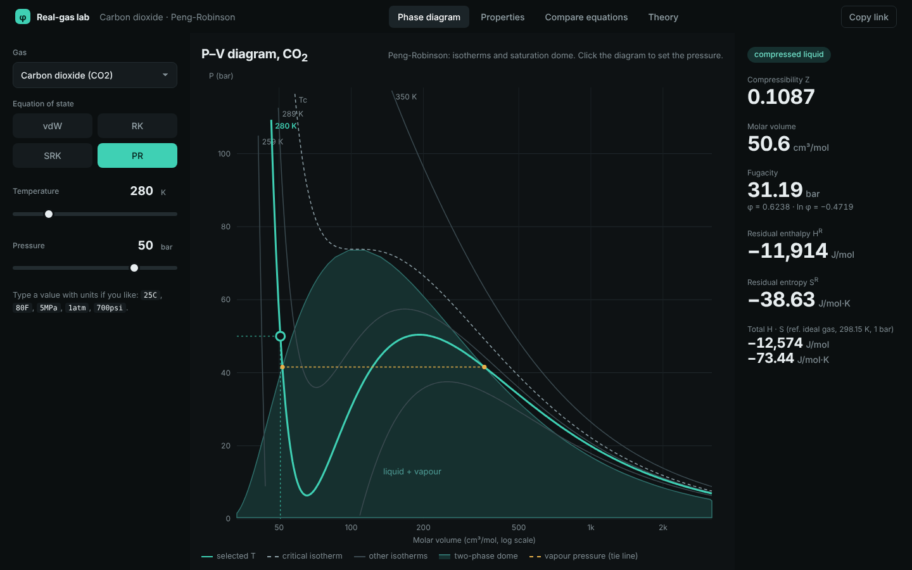

# Real-gas lab

Predict the behaviour of real gases with cubic equations of state: **PVT (compressibility), fugacity, residual and total enthalpy and entropy, and vapour pressure** for 22 pure gases, using the van der Waals, Redlich-Kwong, Soave-Redlich-Kwong and Peng-Robinson equations.

Chemical engineering thermodynamics computer project (PVT behaviour, H and S, pure-component fugacity).



**Live site:** `https://andrew-xvi.github.io/real-gas-lab/`

## What it does

| View | Shows |
| --- | --- |
| Phase diagram | P–V isotherms, saturation dome and the state point; drag the sliders or click the diagram to set P |
| Properties | all roots of the cubic, stable phase (lowest ln φ), total H and S, vapour pressure and heat of vaporisation, ΔH and ΔS to a second state |
| Compare equations | the four equations side by side and curves of Z, φ, H^R, S^R against pressure |
| Theory | equations and notes on the method |

Inputs accept units: `25C`, `80F`, `5MPa`, `1atm`, `700psi`. The page address stores the state, so **Copy link** shares exactly what you see. You can also enter your own gas (Tc, Pc, ω, Cp coefficients).

## Run it

The website is plain HTML, CSS and JavaScript: open `index.html` in a browser. No build step and no server are needed.

The same calculations are available as a Python program with a guided prompt interface:

```bash
pip install numpy scipy
python python/cubic_eos.py
```

## Tests

```bash
node tests/test_eos.mjs            # the JavaScript engine against the Python program: 2,760 states
pip install numpy scipy CoolProp
python python/validate.py          # consistency checks and independent cross-check with CoolProp
```

* H^R and S^R agree with the numerical temperature derivative of ln φ; fugacities are equal at the vapour pressure; ΔH^vap satisfies the Clapeyron equation.
* The Python results agree with the PR and SRK implementations in CoolProp to about 1e-9.
* The JavaScript results agree with the Python results to about 1e-14.

## Files

```
index.html, css/, js/       the website (eos.js = calculation engine, app.js = interface, gases.js = data)
python/                     cubic_eos.py (guided program), validate.py, make_figures.py
tests/                      JavaScript test and reference values from the Python program
docs/report.pdf             project report (4 pages) with its LaTeX source
```

## Method and data

Generic cubic equation `P = RT/(V−b) − a(T)/((V+εb)(V+σb))`; fugacity coefficient `ln φ = Z − 1 − ln(Z−B) − (A/B)·I`; departure functions from the same quantities; total H and S from ideal-gas Cp polynomials with H = S = 0 for the ideal gas at 298.15 K and 1 bar. See the Theory view and `docs/report.pdf`.

Tc, Pc, ω and Cp data: J. M. Smith, H. C. Van Ness, M. M. Abbott, *Introduction to Chemical Engineering Thermodynamics*, Tables B.1 and C.1. Cubic equations are approximate: they are weakest for liquid volumes, near the critical point and for polar fluids.

## Authors

Name 1 (Roll No.), Name 2 (Roll No.), Tutorial group …
